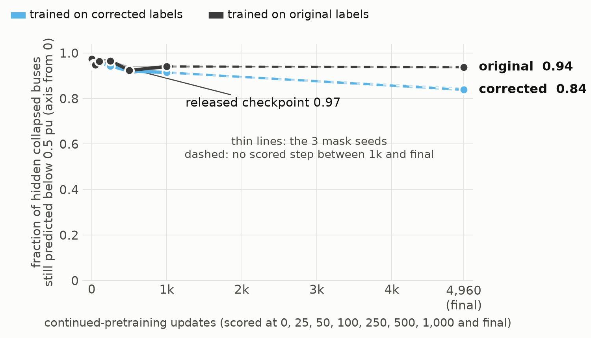

# GENCO infers missing bus voltages zero-shot, and 3% of its pretraining labels are collapsed power-flow roots

**Participant:** Mazin Al-Mahrouqi, The Ohio State University · **Contact:** mahrouqi.1@osu.edu · **Code and result files:** <https://github.com/mahrouqi1/grid-operations-genco>

## Summary

We audited GENCO's released pretraining data and tested what the released checkpoint can do on new grids without fine-tuning. Four results:

1. **About 3% of the sampled pretraining labels are collapsed power-flow roots, and GENCO's response to them depends on the task.** The collapse comes from the data generator's fast power-flow call. Under its masked pretraining task the model reproduces the collapsed voltages at 96% of hidden collapsed buses. On the power-flow task it avoids them: at the collapsed buses its voltage magnitudes are closer to a recovered power-flow solution than to the stored label in all 1,083 scored scenarios (median difference 0.008 pu).
2. **Without fine-tuning, GENCO infers missing bus voltage magnitudes better than graph interpolation.** With 40% of bus voltages measured, it beats the best of five learning-free graph interpolators on 33/36 carved subgrids and 12/15 locked-benchmark grids; with 20% measured, the level GENCO sees in pretraining, it wins 8/15. A weighted-least-squares state estimator that knows the grid model and generator limits remains more accurate.
3. **Continued pretraining of the released checkpoint did not improve it in our runs.** None of 30 runs (7 recipes, then 3 targeted fixes, 3 seeds each), nor a control on SimBench grids GENCO never saw, beat the released model on a 15-grid benchmark. A from-scratch pair on original versus corrected labels was too short (1.3% of the paper's schedule) to say anything.
4. **Zero-shot power flow with every input known matches the paper's stated limitation.** On the 15 benchmark grids the released checkpoint's branch-angle error is a median 3.7 times that of DC power flow. The paper reports the same limitation and closes it with about 1,000 grid-specific fine-tuning samples.

We release the RepairKit, which checks datakit-format datasets, attempts label repair and verifies the repaired tables, together with the checksums of the corrected tables and the command that regenerates them.

## Setup

We use the released checkpoint (20,069,187 parameters) and GENCO's own data tools (gridfm-datakit, gridfm-graphkit). We first reproduced the paper's case118 zero-shot transfer number to within 1e-5 MW (11.078244 against 11.078253 published). The voltage-inference, continued-pretraining and power-flow tests had protocols committed before their results existed; the label diagnostics are exploratory.

The test sets:
- **Locked benchmark:** 15 PGLib grids from 5 to 3,120 buses, fixed before the later experiments. It shaped earlier work, so it is a benchmark, not a blind test.
- **Carved subgrids:** 36 networks of 159 to 903 buses cut from larger grids, 19 from families in GENCO's pretraining ("seen") and 17 from families it never saw (RTE, PEGASE, Polish).
- **Whole grids:** 15 from seen families and 17 from unseen families (RTE, PEGASE, Polish, SimBench HV).

## 1. Collapsed labels in the pretraining data

**What we found.** 1,085 of 34,274 sampled pretraining scenarios have a bus voltage below 0.5 pu or a negative one. 1,069 of them (3.1%) are collapsed, and the other 16 are sign flips only. In 941 of the 1,085 the lowest bus voltage is within 0.1 pu of zero.

**Where it comes from.** The data generator runs PowerModels' fast power-flow call, a trust-region solver from a flat start, in the setting GENCO's own data log records. Rerunning that call on GENCO's published raw tables reproduces the published label to below 1e-6 pu on 51 of 51 sampled collapsed scenarios, from all 9 affected subgrids. We traced the root on PGLib grids we generated with the same call: on case1354 the solver converges to the trivial Vm = 0 root at a zero-injection leaf bus (no load, no generator), which holds 93% of the collapsed buses there, and on case240, case2736sp and case2746wop every collapsed bus is zero-injection. On the RTE grids and case2869 the collapsed buses form a broader low or negative voltage family. Switching the call to PowerModels' Newton method repaired 106 of 110 collapsed scenarios on our grids but only 15 of 51 on GENCO's published subgrids, where it mostly fails to converge. Our two-start relabeler repaired all of them (below).

**What the model learned from them.** Under the pretraining mask, the released model predicts the collapsed voltage at 96% of hidden collapsed buses, and at least 75% on each of the 9 affected subgrids. Under the power-flow task on the same systems, it predicts a collapsed voltage at 0 of 1,143 hidden collapsed buses. At those buses it lands a median 0.008 pu from a physical solution, while the label is a median 1.135 pu away.

To get the physical solutions we ran Newton's method from flat and DC starts, from neighbouring scenarios of the same subgrid, and by continuation from healthy scenarios. This found a solution with every voltage at least 0.5 pu and a power mismatch below 1e-9 pu for all 1,083 scored scenarios. For 1,070 of them, two different starts reached the same solution; for the other 13, the stored label satisfies the power-flow equations once its sign error is removed. At the 1,156 flagged buses, 1,148 of the solutions sit at 0.9 pu or above, so the 0.5 pu threshold separates the two groups cleanly. 40 solutions have a voltage below 0.70 pu, and a scenario can have more than one solution, so the result is "near a physical solution", in magnitude, not "the unique solution". We do not know whether the power-flow behaviour comes from pretraining or from the extra inputs the power-flow task supplies.

**Retraining on corrected labels.** Continued pretraining on corrected labels lowered the share of hidden collapsed buses still predicted below 0.5 pu to 0.80 (0.70 to 0.83 over three training seeds), against 0.94 with the original labels and 0.97 for the released model. Both label sets made held-out branch-angle error worse than the released model's (median 1.16 times with corrected labels, 1.33 times with original), so this short continuation is not a usable corrected model. The run lasted 4,960 updates, about 0.06% of the paper's 8.73M, and in training seed 200 the share falls from 0.97 to 0.91 by 1,000 updates and to 0.84 by the end, with no scored checkpoint in between. Whether longer training lowers the share further, we did not test. For the two added seeds, the original weight-identity check failed and its replacement was chosen after the results were seen; the seed report documents this.

## 2. Zero-shot voltage inference

**Task.** Loads are known, generator dispatch is not, and |V| is measured at a seeded fraction of buses. The released checkpoint, unchanged, predicts |V| at the other buses. The GENCO paper studies state estimation by training a separate model per grid (its section 5.3); here we ask whether the pretrained checkpoint already does masked voltage inference on new grids.

**Baseline.** Interpolation over the network graph uses the same inputs GENCO gets (topology, admittances, loads, measured voltages) and no training, so it tells us whether GENCO adds anything beyond smoothing over the grid. We take the best per grid of five: harmonic, admittance-weighted, nearest electrical neighbour, load-aware, and graph kriging.

**Why 40%.** GENCO's pretraining hides each bus voltage with probability 0.8, so it sees about 20%. We fixed three levels in advance, 10%, 20% and 40%. On the locked 15 GENCO wins 6/15, 8/15 and 12/15 at those levels, against a pre-set bar of 10. We report the other sets at 40%.

A win means GENCO's error is lower than the best interpolator's and the upper end of the 95% bootstrap interval of the ratio is below 1.

| Test set (40% measured) | GENCO wins |
|---|---|
| Carved subgrids, all | 33/36 |
| of which seen families | 19/19 |
| of which unseen families | 14/17 |
| Same subgrids, a second scenario generator | 30/36 |
| Locked benchmark | 12/15 |
| Whole grids, seen families | 15/15 |
| Whole grids, unseen families | 8/17 |

With 0.5% measurement noise, GENCO still wins 23/36 carved subgrids, 8/15 seen-family whole grids and 2/17 unseen-family whole grids.

GENCO does best on families it saw in pretraining. Under one scenario generator, seen pieces win 19/19 and unseen pieces 11/17 (p = 0.006, Fisher's exact test, secondary). The pieces are not independent, since they come from 7 and 6 parent grids; a permutation test over parents gives p = 0.021. Two registered tests did not reach significance (p = 0.095 and 0.245). It also wins 12 of the 15 locked grids, none of them from its pretraining families, so family is not the whole story.

**Against a state estimator.** We added a weighted-least-squares (WLS) estimator on the same scenarios and masks (mask seed 0, first 30 scenarios per grid, 10 on whole grids). It uses the known loads, the grid model and the generator limits. We ran it two ways: with the true limits, and active-limit-blind, with every generator's Pmax set to the median and Pmin to 0 (reactive limits unchanged), because WLS builds its dispatch prior from those limits. GENCO sees the true limits in both comparisons. Each ran with 40 iterations in its first stage and 60 in its second (40/60). Median ratio of GENCO's error to the WLS error (above 1 means WLS is more accurate):

| Set | WLS, true limits | WLS, active-limit-blind |
|---|---|---|
| Carved subgrids | 10.3 | 3.6 |
| Locked 15 | 2.8 | 1.4 |
| Whole grids, seen | 8.8 | 1.16 |
| Whole grids, unseen | 6.2 | 1.39 |

Against the interpolators plus WLS with true limits, GENCO wins 2/36 carved subgrids and 1/15 locked grids; against the interpolators plus active-limit-blind WLS, 4, 2, 1 and 2. WLS does not always converge: with true limits it fails on 17% of locked-benchmark scenarios, 11% and 30% of seen and unseen pieces and 49% of whole-grid scenarios, and active-limit-blind it fails on 35% of piece scenarios, 25% of locked-benchmark scenarios, 81% of seen-family whole-grid scenarios and 44% of unseen-family whole-grid scenarios. Replacing each failed solve with the fixed I2 interpolator (harmonic interpolation weighted by branch admittance) gives 4 of 36 and 1 of 15 instead. At the iteration limit we first used (8/12), 60% of its solves with the true generator limits hit the iteration cap, and the active-limit-blind version hit it on 88% of piece scenarios and 99% of seen-family whole-grid scenarios. Where WLS converges with good generator information, it is the more accurate tool.

## 3. Continued pretraining

We continued pretraining the released checkpoint on 37,000 operating points we generated on 21 grids, plus GENCO's corrected original training data (7,929 graphs), mostly on OSC (73.4 GPU-hours for the first set). The first set tried 7 recipes (masking policies and data mixes) with 3 seeds each; the second tried a lower learning rate, a frozen backbone and 9 times as much original data. Protocols were frozen before the runs, with a leakage check (maximum branch-impedance Jaccard 0.16 on the grids kept). None beat the released model on the locked 15. At matched 12,000 updates, branch-angle error was 21% worse with original data only and 54.5% worse with our generated data. The run that validation selected was 50% worse (5.52 against 3.69 times DC), and validation chose the released weights themselves in 6 of 21 runs. About three quarters of our training graphs came from GENCO's own families, so we also trained on the SimBench HV grids, which GENCO never saw, with the corrected original data. That control was also no better than the released model (4.4 times DC at 12,000 updates, against 3.7), so these runs do not separate the training recipe from grid-family novelty.

The from-scratch pair trained GENCO's architecture on 28 of its 100 pretraining subgrids for about 115k updates (1.3% of the paper's 8.73M), once on original and once on corrected labels. Both failed the underfit check we set in advance, so it is uninformative about whether corrected labels change what GENCO learns.

## 4. Zero-shot power flow

With every power-flow input known, the released checkpoint's branch-angle error is a median 3.69 times that of DC power flow on the locked 15. This is the limitation the paper states: zero-shot transfer to a new topology is unsolved, and on IEEE 118 the pretrained model needs about 1,000 grid-specific fine-tuning samples to beat DC power flow. Our continued pretraining did not close the gap. Two fast-decoupled iterations from a DC start (fd2) are a stronger classical reference than DC alone: no GENCO variant we tried beat it on branch angle or voltage magnitude, and it takes roughly 10 to 65 ms per scenario on grids of 1,900 to 9,300 buses on a shared workstation. With 100 labels, fine-tuned GENCO beat DC on 7 of the 12 grids we ran. Larger fine-tuning sets, as in the paper, are the route the evidence supports.

## Limitations

- The locked benchmark shaped earlier work, so it is not a blind test, and the carved subgrids come from few parents.
- GENCO's input normalizer is fitted on the target grid's solved scenarios, so the weights are unchanged but the preprocessing is not label-free; we have not measured the effect of that scaling.
- The state-estimator comparison is one configuration: 40% measured, no noise, one mask seed. Its parameters were tuned on two scored grids.
- The zero-injection mechanism is traced on PGLib grids we generated, not on GENCO's published subgrids, and not on the RTE grids.

Result files and claims were checked in repeated rounds by separate AI review sessions; the three newest training results remain marked unaudited in their reports. If a number does not match its result file, please tell us.

## Code and data

Code, result files and figure scripts: <https://github.com/mahrouqi1/grid-operations-genco> (Apache-2.0 for code, CC BY 4.0 for results and figures). `bash reproduce.sh` checks the files, rebuilds the figures and runs the tests; the README says what rerunning the scoring needs.

## Next steps

We would be glad to work on these with GENCO's authors and other users: GENCO as a learned prior inside WLS state estimation; a datakit power-flow call that avoids the collapsed roots on GENCO's own subgrids; and a cleaner test of whether unfamiliar grid families limit transfer. If any of these overlaps with your work, or you have a number that disagrees with ours, write to mahrouqi.1@osu.edu.
